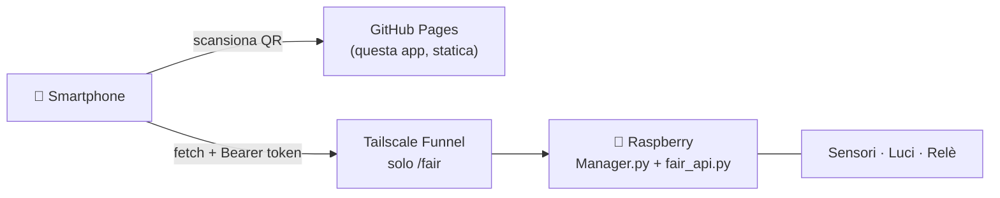

<div align="center">

# 🏢 Building Live

**Il tuo edificio, in tempo reale, sul telefono.**
Mappa live di temperatura, CO₂, umidità e luce, con spettro colore e controllo delle luci.

[](https://github.com/ITS-GDS/BuildingManager_APP/actions/workflows/pages.yml)


[**▶ Demo live**](https://its-gds.github.io/BuildingManager_APP/?demo) · [Avvio rapido](docs/AVVIO_RAPIDO.md) · [Architettura](docs/PLAN.md)

<!-- Aggiungi qui uno screenshot o una GIF:  -->

</div>

---

## ✨ Funzionalità

| | |
|---|---|
| 🗺️ **Pianta interattiva** | Zone colorate per metrica (temperatura, CO₂, umidità, luce), una tab per piano |
| 📈 **Storico** | Scheda per zona con valore, sparkline e grafico scorrevole |
| 🌬️ **Aria** | CO₂ con giudizio sulla qualità, persone stimate dal bilancio di massa, avviso porta/finestra aperta |
| 🌈 **Luce** | Spettro a 8 canali (AS7341) su curva a colori reali, temperatura di colore |
| 💡 **Luci** | Dimmer e colore delle lampade direttamente dal telefono |
| 🔌 **Relè** | Stato di HVAC, ventola e umidificazione |
| 🔒 **Accesso con QR** | Token firmato a scadenza, revocabile in un click |
| 🧪 **Modalità demo** | Dati simulati, nessun hardware necessario |

## 🚀 Provalo in 30 secondi

```bash
git clone https://github.com/ITS-GDS/BuildingManager_APP
cd BuildingManager_APP
python -m http.server 8000
```

Apri <http://localhost:8000/?demo>. Serve `http://`: aprire `index.html` con doppio clic non funziona (moduli ES).

## 🧩 Come funziona



1. Il pannello `/fair-admin/` (solo rete locale) genera un **QR** con un token firmato a scadenza.
2. Il QR apre `https://<pages>/#t=TOKEN&a=https://<host>.ts.net`. Il token sta nel frammento dell'URL, quindi non finisce nei log dei server.
3. L'app salva il token, ripulisce l'URL e interroga `/fair/api/state` ogni ~2 s.
4. **Revoca tutti** cambia il segreto e invalida ogni QR emesso.

Il server vive in un altro repo: [Building_Manager](https://github.com/adelpra2527vi4/Building_Manager) (`fair_api.py`, `setup_fair.sh`).

## 🛡️ Sicurezza

- Funnel espone solo `/fair`: dashboard e comandi non sono raggiungibili da internet.
- I comandi (es. dimmer luci) richiedono sempre un token valido; `FAIR_OPEN=1` apre solo le **letture**, per test in LAN.
- CORS limitato agli origin in `FAIR_ORIGINS`; rate limit lato server.
- `api.js` accetta come indirizzo solo `https` su `*.ts.net`.
- Limite noto: chi riceve il link può inoltrarlo fino alla scadenza del token (1–72 h).

## 🗂️ Struttura

```
index.html          markup
css/app.css         stile
js/main.js          stato, polling, schede zona e pannelli
js/api.js           sessione/token e chiamate al Raspberry
js/map.js           pianta e poligoni delle zone
js/fx.js            spettro, contatori animati, sparkline
js/scales.js        scale colore e colorimetria
js/occupancy.js     stima persone dalla CO₂
js/demo.js          dati simulati (?demo)
docs/               piano, contratto API, avvio rapido
```

## 📦 Pubblicazione

Push su `main`: il workflow [`pages.yml`](.github/workflows/pages.yml) pubblica su GitHub Pages. In *Settings → Pages* scegli **GitHub Actions** come sorgente.

## 📄 Licenza

[MIT](LICENSE)
